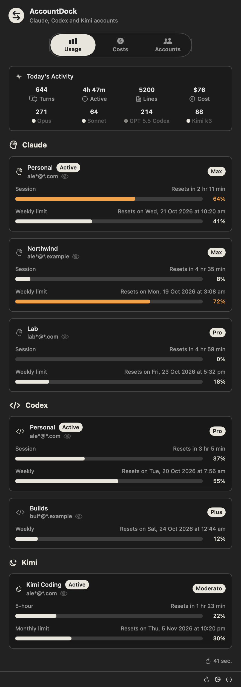
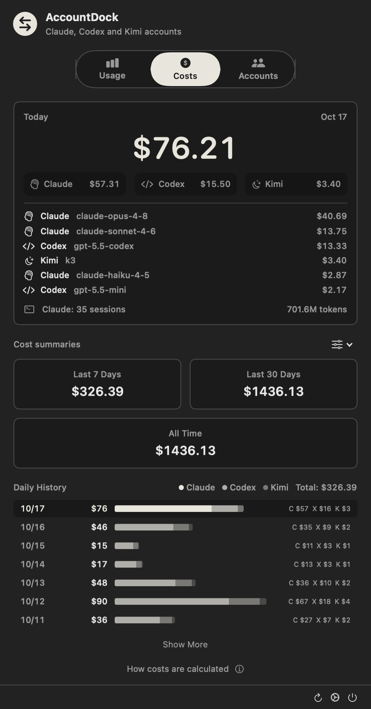
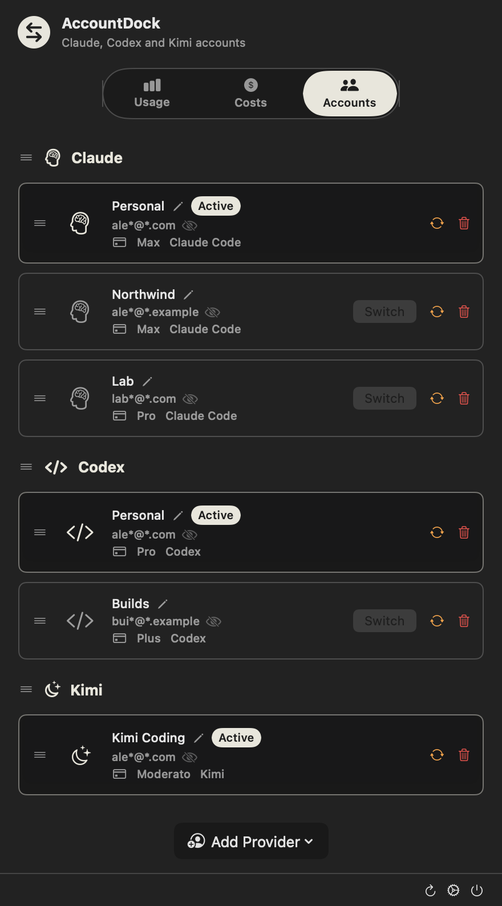
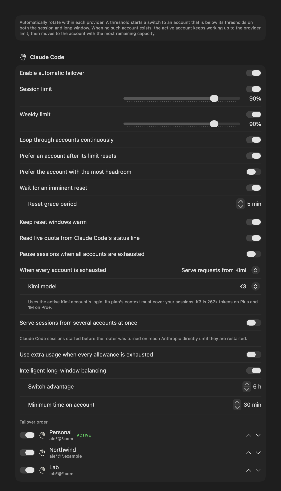
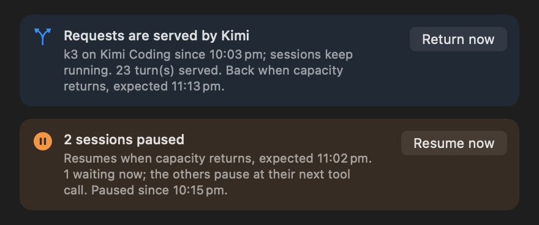

# AccountDock

One dock for every local AI coding identity.

AccountDock is a native macOS menu-bar app for people who run Claude Code,
Codex and Kimi Code on more than one account. It keeps each account's
credentials apart, switches the account each CLI uses, shows every account's
quota, cost and activity in one place, and moves work between accounts on its
own before a limit stops you.

<p align="center">
  
</p>

<p align="center">
  
  
  
</p>

## Highlights

- **Every account in one place.** Add, label, reorder, re-authenticate, remove
  and switch Claude Code, Codex and Kimi Code accounts. Each keeps an isolated
  credential, and switching never writes an incomplete or dead credential into
  a CLI's live slot.
- **Quota at a glance.** Session, weekly and monthly windows for every account,
  with reset times, in the menu and the menu bar. Model-scoped weekly limits
  are read and planned for.
- **Costs and activity.** API-equivalent cost per provider and model, daily and
  30-day history, turns, active time and lines changed, all computed locally
  from session logs.
- **Automatic failover.** Each provider rotates through its own accounts on
  thresholds you set, plans ahead with learned usage rates, and never switches
  to an account that would run out straight away.
- **No failed requests at the limit.** When every account is spent, Claude Code
  sessions can keep running on a route target such as Kimi and return when
  Claude has capacity, or sessions can pause and resume on their own.
- **Several accounts at once.** Claude Code sessions can each be served by
  their own account, so several 5-hour windows are used in parallel.
- **Configurable menu bar.** Rings, bars, percentages, countdowns, account and
  cost modules, in any order.
- **Private by design.** No prompts or transcripts are stored or sent anywhere.
  Credentials stay in the macOS Keychain and in memory.

## Usage and costs

The **Usage** tab lists every account by provider, in the order you set in
**Accounts**: its plan, the session (5-hour) window, the weekly or monthly
window, and when each resets. Today's activity across all providers sits on
top. The **Costs** tab totals today's API-equivalent spend by provider and
model, with 7-day, 30-day and all-time summaries and a daily history.

Usage comes first from what the CLIs already record (Claude Code's status line
and cache, Codex rollouts, the router's response headers). Provider usage
endpoints are called sparingly within a per-provider request allowance: the
active account whenever a decision depends on it, idle accounts every half
hour. Costs are computed from local session logs and Claude totals match
[ccusage](https://github.com/ryoppippi/ccusage); see
[COST_VERIFICATION.md](COST_VERIFICATION.md).

## Automatic failover

<p align="center">
  
</p>

Settings → Failover configures Claude Code, Codex and Kimi Code independently.
Work never moves from one provider's accounts to another's, apart from the
request router's route target below.

- **Thresholds.** A session and a long-window threshold per provider. Crossing
  either moves work to the next account, in your order, that is below **both**
  of its thresholds with room to stay there for a while.
- **No switch loops.** When no account is below its thresholds, the active
  account keeps working up to the provider's 100% limit, then moves to the
  account with the most room left. An account that is merely less full than its
  threshold is never chosen.
- **Fresh data.** An account other sessions may still be using is read again
  before AccountDock switches to it.
- **Ahead of time.** Decisions look 30 seconds ahead and use each account's
  learned usage rate plus its variability, so several agents finishing the last
  few percent between two checks cannot overrun a limit. Work also moves while
  there is still room for the requests already under way.
- **Worthwhile destinations.** When the active account is at its limit, work
  moves only to an account with room for at least ten minutes of the current
  use; a sliver of allowance would be gone before the move paid for itself.
- **Reset-aware.** Hold briefly when a limit resets before the account would
  run out, and optionally prefer an account whose limit has just reset.
- **Keep windows warm.** Optionally make one minimal request right after a reset
  is confirmed, so the next countdown starts immediately. The probe never
  becomes a resumable session.
- **Intelligent balancing.** Optionally spend accounts in the order their weekly
  allowance would otherwise expire unused. Once AccountDock has learned a day of
  your usage pattern, it simulates the coming week to choose, and shows a
  one-line outlook for the week.
- **Pace estimate.** Under each provider, while its active account is in use:
  when that account reaches its limit at the current pace, and when every
  included account would be used up and sessions paused.
- **Quarantine.** An account whose stored credential fails verification is left
  out of automatic switching until you re-authenticate it.

The planning rules and the maths behind them are in
[ARCHITECTURE.md](ARCHITECTURE.md#failover-planning).

### When every account is exhausted

<p align="center">
  
</p>

Choose what happens for each provider:

- **Serve requests from a route target** (Claude Code). Claude Code's requests
  go to the target through AccountDock's local router and come back to Claude
  as soon as an account has capacity. Sessions stay open the whole time. Kimi
  is the available target; pick the Kimi model. Only models with a context
  window of at least 1M tokens are offered (K3, K3.1 Pro, K3.1 Pro high speed
  and Kimi for Coding), since a session moves with its whole conversation.
  Kimi counts every routed token
  against its 5-hour window, so AccountDock routes only sessions up to a
  context size you set, keeps a share of Kimi's window for your own Kimi
  sessions, and routes only when Kimi would last a set time at the current
  demand. Sessions larger than that context size (90% of the model's window
  unless you set another) are paused while the rest run on Kimi, including at their next
  prompt, and resume on Claude as capacity returns. **Return now** sends
  requests back at once.
- **Pause sessions.** Every session waits at its next tool call, including
  subagents and workflow agents, and a turn started during the pause waits
  before its first request, so nothing is sent to an account that would refuse
  it. **Pause sessions now** in the failover settings starts a pause yourself,
  for instance before switching to an account at its limit; it holds until you
  resume or an account in the failover order has capacity. The
  terminal stays attached and usable, and a message shows why. While an account
  still has a little room, paused sessions are let through one step at a time.
  Everything continues on its own when capacity returns, or with
  **Resume now**. To let one session go on while the rest stay paused, press
  ⌃⌥⌘R with its terminal in front, or choose it under **Resume one**.
- **Use extra usage** (Claude Code, combines with the options above). Accounts
  with extra usage enabled keep serving past their plan, up to a monthly
  spending limit you set, before AccountDock routes or pauses.
- **Do nothing.** AccountDock waits and switches to the account whose limits
  reset first.

### Serving sessions from several accounts

With **Serve sessions from several accounts at once**, each Claude Code session
is served by its own account through the router and keeps it while that account
has room. Several accounts' 5-hour windows are used in parallel instead of one
after another. The account cards show how many sessions each account served in
the last ten minutes.

**Pace sessions to each account's 5-hour window**, on by default, spreads them
by how fast each account is being used. New sessions go to the accounts with
the most unused rate for the rest of their window. A session stays on its
account while its prompt cache lasts. When an account's sessions would reach
its limit and stay there for longer than their cache lasts, some of them move
at their next turn to accounts that can carry them. Otherwise they stay, and
a session that reaches the limit with the reset at most five minutes away
waits for it on its own account and continues with its cache. When the reset
is further away but still comes before the working sessions' caches expire,
those sessions wait at their next tool call and continue on their account
after it resets, instead of writing their whole context again elsewhere.
Sessions whose next turn comes soon move before one deep in a long turn.

**Keep prompt caches for an hour**, on by default, extends Claude Code's own
one-hour prompt cache. On a subscription Claude Code already uses the hour
for its main conversation, but five minutes for subagents, workflow agents and
background requests, and for everything while the account is on extra usage.
The router asks for the hour on every request, so one that comes after a
longer gap reads its context back cheaply instead of writing it again. The
setting shows what the hour saved and cost over the last week. Claude Code's
own `promptCacheTtl` and `subagentPromptCacheTtl` settings, set to `"1h"`, do
the same for sessions started after they are set.

### Resuming paused sessions as capacity allows

With **Resume sessions as capacity allows**, paused Claude Code sessions don't
all continue the moment one account resets. AccountDock forecasts each
session's use from the hour before it paused and lets them continue a few at
a time, each on an account where that use fits before the account's window
resets. The session doing most of the work goes first and smaller ones fill
what is left, and as more accounts reset, more sessions continue, spread
across them. A resumed session is paused again if its account nears its limit
anyway.

### The request router

The router is a small helper that AccountDock installs, updates and removes on
its own. It runs while Claude Code failover, a route target or several-account
serving is on. A running Claude Code session keeps the credential it already
holds, so without the router a switch reaches running sessions only late; with
it, every session moves to the newly active account at its next turn, and a
request an account refuses at its limit is sent again on the next account
instead of failing. It listens on `127.0.0.1` only,
refuses requests from web pages, and serves your accounts only to clients that
already hold one of your credentials. Credentials are passed to it from the
Keychain over an authenticated local connection and kept in memory, never on
disk. Requests that lose their connection to Anthropic before any reply are sent
again on a fresh connection. When the route target reaches its own limit,
sessions return to Claude at once; with every option out, a session gets
Claude's own limit reply, so Claude Code waits for the reset and continues by
itself. An interrupted turn stops the upstream reply. Claude Code sessions started before the router was
enabled keep talking to Anthropic directly until they are restarted. Details are in
[ARCHITECTURE.md](ARCHITECTURE.md#request-router).

## Agent hooks

AccountDock adds a few hooks to each CLI's settings, alongside your own:

- session lifecycle records, used to recover sessions after a Codex switch;
- Claude Code's status line, so every response's quota reaches AccountDock
  without an extra request (your own status line keeps working);
- the pause gate;
- `ANTHROPIC_BASE_URL`, only while the router is in use.

On launch, AccountDock asks to install any that are missing.
Settings → General → Agent hooks shows each one and can reinstall them. Each
settings file is backed up once before the first change, for example
`~/.claude/settings.json.accountdock-backup`. Session records hold the session
ID, working directory, state, host and time, never prompt or transcript content.

## Switching and session recovery

**Claude Code.** Switching replaces the credential Claude Code uses and checks
the result with `claude auth status`, rolling back if the target is rejected.
Running sessions are never terminated or restarted.

**Codex** has three switch methods for automatic failover:

- **Switch Safely** waits until a running session records an actual usage-limit
  error, then restarts and resumes only the affected sessions; the others
  reload the new credential in place.
- **Force Restart Sessions** closes every detected Codex Terminal session,
  switches, and reopens each with `codex resume <session-id>`.
- **Switch Without Restart** signals compatible Codex processes to reload the
  credential in place.

Standalone sessions reopen in their original directory; IDE sessions reconnect
through their host. Codex lifecycle hooks need a Codex build that supports them
(the `bbmumford/codex` fork); on other builds they are inert.

**Kimi Code.** The Accounts tab can capture the current Kimi Code login or run
`kimi login`. Each subscription keeps an isolated credential, and Kimi's
rotating refresh tokens are written back before use.

## Failover log

Settings → Log records switches, waits, routing, pauses, recoveries and
failures. Account identity is obfuscated, entries are capped at 500 and stored
locally at `~/Library/Logs/AccountDock-failover.json`, and the log can be
cleared from the app.

## Requirements

- macOS 14 or newer
- Claude Code, Codex or Kimi Code installed for the providers you use
- For development: Xcode 16 or newer and XcodeGen (`brew install xcodegen`)

## Install

The repository is private, so sign in once with `gh auth login`, then run:

```bash
install_dir="$(mktemp -d)" && gh release download --repo bbmumford/AccountDock --pattern 'AccountDock.pkg*' --dir "$install_dir" --clobber && (cd "$install_dir" && shasum -a 256 -c AccountDock.pkg.sha256) && sudo installer -pkg "$install_dir/AccountDock.pkg" -target / && osascript -e 'tell application "System Events" to if not (exists login item "AccountDock") then make login item at end with properties {name:"AccountDock", path:"/Applications/AccountDock.app", hidden:false}' && rm -rf "$install_dir" && open -a AccountDock
```

The command downloads the latest release, verifies its SHA-256 checksum,
installs it in `/Applications`, adds the Claude Code and Codex session hooks to
the current user's settings, adds AccountDock to Login Items and opens it. On
first launch the app offers to install the remaining hooks.

AccountDock checks GitHub for newer releases and shows the same kind of command
in Settings → About. It never downloads or runs an update itself.

## Build and test

```bash
xcodegen generate
DEVELOPER_DIR=/Applications/Xcode.app/Contents/Developer \
  xcodebuild test \
  -project AccountDock.xcodeproj \
  -scheme AccountDock \
  -destination 'platform=macOS' \
  -derivedDataPath /tmp/AccountDockDerivedData \
  CODE_SIGNING_ALLOWED=NO
```

`project.yml` is the source of truth; regenerate the project after changing it.
Release builds, packaging and versioning are in [BUILD_GUIDE.md](BUILD_GUIDE.md).

The screenshots above are rendered from the app's own views with sample
accounts, never real ones:

```bash
Tools/render_screenshots.sh   # writes docs/images/*.png
```

## Source layout

| Path | Contents |
| --- | --- |
| `AccountDock/` | App: models, services, SwiftUI views, resources and localizations |
| `AccountDockRouter/` | The local request router (`Core/` is shared with the app) |
| `AccountDockWidget/` | WidgetKit extension |
| `AccountDockTests/` | Unit tests |
| `Shared/` | Widget data shared by the app and the widget |
| `Tools/` | Cost verification, pricing refresh and screenshot rendering |
| `scripts/` | Release helper, hook configurators and installer scripts |
| `docs/` | Images, the Kimi provider design and archived upstream docs |
| `project.yml` | XcodeGen project definition and version source |

## Extending

**A provider.** Every provider is declared once in
`AccountDock/Models/ProviderCapabilities.swift`: identity, quota windows,
workload eligibility, pricing, how switching reaches running sessions, its
pause gate and lifecycle hooks, a live usage feed, whether the router serves
it and whether it offers a route target. Add a service for authentication,
credential storage, plan discovery, usage and CLI switching, give each adapter
in [ARCHITECTURE.md](ARCHITECTURE.md#providers) its case, then register the
capabilities. Accounts, usage reading, failover, pausing, routing, hooks, costs,
the menu bar and the settings pick it up from the registry.

**A route target.** Set a `RouteTarget` as its provider's `routeTarget`
capability and supply its token in `AppState.accessCredential`. The router
needs no change.

## Documentation

- [ARCHITECTURE.md](ARCHITECTURE.md): components, credentials, failover
  planning, pausing, the request router, hooks and files.
- [BUILD_GUIDE.md](BUILD_GUIDE.md): building, versioning, CI and releases.
- [RELEASE_NOTES.md](RELEASE_NOTES.md): what changed in each version.
- [COST_VERIFICATION.md](COST_VERIFICATION.md): keeping costs aligned with ccusage.
- [docs/KIMI_PROVIDER_ASSESSMENT.md](docs/KIMI_PROVIDER_ASSESSMENT.md): the Kimi
  provider design.

## Upstream attribution

AccountDock began as a hard fork of
[XueshiQiao/CCSwitcher](https://github.com/XueshiQiao/CCSwitcher) and was
informed by the account-isolation and telemetry approaches in
[steipete/CodexBar](https://github.com/steipete/CodexBar).

The reviewed CCSwitcher revision did not contain a repository license. Public
redistribution requires permission from its copyright holder. Archived upstream
documentation is kept under `docs/upstream/`.
