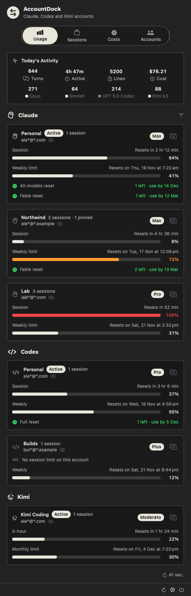
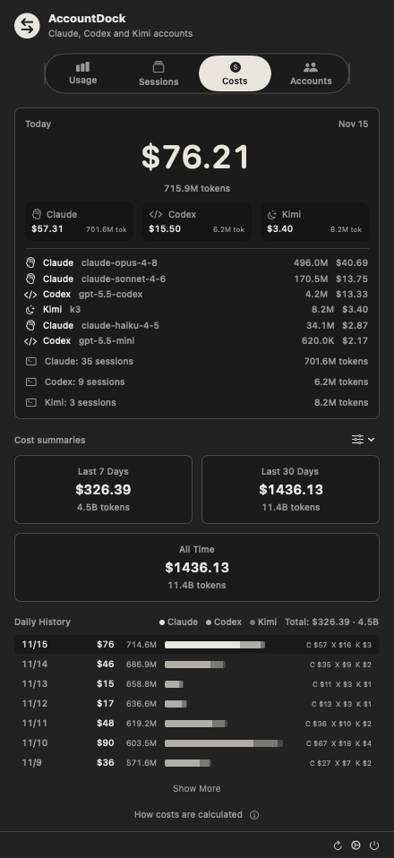
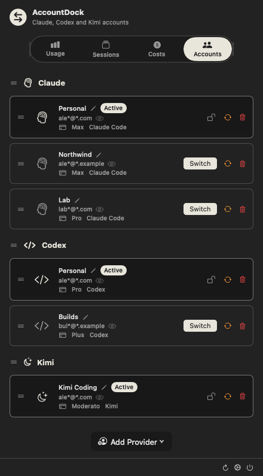
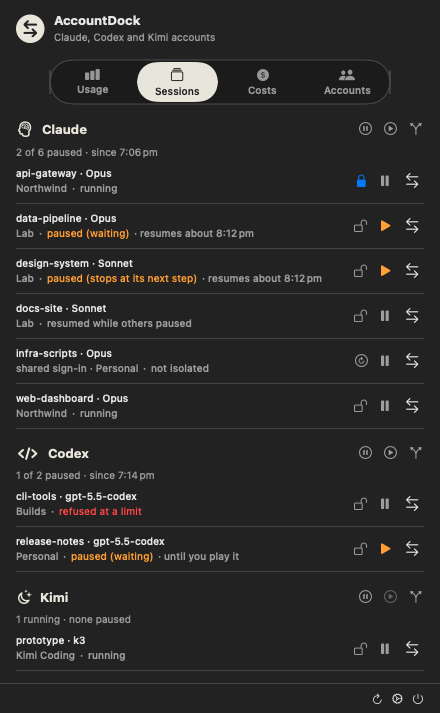
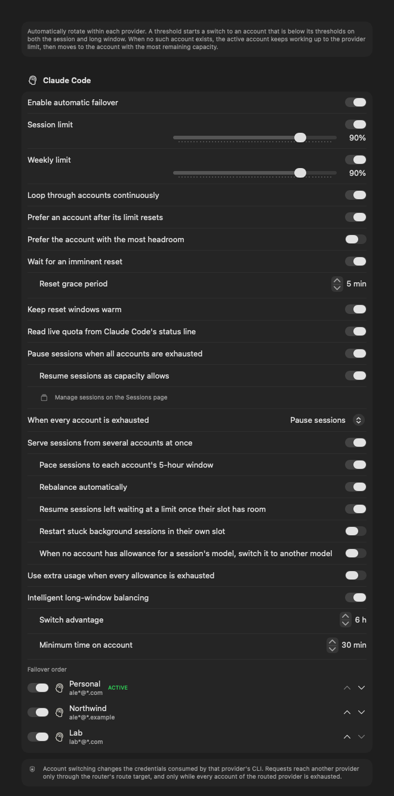
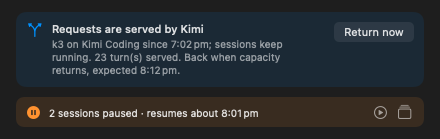

# AccountDock

One dock for every local AI coding identity.

AccountDock is a native macOS menu-bar app for people who run Claude Code,
Codex and Kimi Code on more than one account. It keeps each account's
credentials apart, switches the account each CLI uses, shows every account's
quota, cost and activity in one place, and moves work between accounts on its
own before a limit stops you, one session at a time when each session runs on
an account of its own.

<p align="center">
  
</p>

<p align="center">
  
  
  
</p>

## Highlights

- **Every account in one place.** Add, label, reorder, re-authenticate, remove
  and switch Claude Code, Codex and Kimi Code accounts. Each keeps an isolated
  credential, a sign-in is saved only once the provider confirms whose it is,
  and switching never writes an incomplete or dead credential into a CLI's
  live slot.
- **Quota at a glance.** Session, weekly and monthly windows for every account,
  with reset times, in the menu and the menu bar. Model-scoped weekly limits
  are read and planned for.
- **Costs and activity.** API-equivalent cost per provider and model, with the
  tokens each cost was priced from, daily and 30-day history, turns, active
  time and lines changed, all computed locally from session logs.
- **Limit resets.** Every subscription shows the limit resets it holds (an
  all-models reset, a Fable reset, Codex reset credits), how many are left and
  the last day to use them.
- **One session, one account.** Claude Code, Codex and Kimi Code sessions can
  each run in a credential slot of their own, so AccountDock moves sessions
  between accounts one at a time and several 5-hour windows are used at once.
- **Every session in reach.** The Sessions tab lists every running session with
  the account serving it, and pins, pauses, plays or moves each one.
- **Failover that knows plan sizes.** Each provider rotates through its own
  accounts on thresholds you set, compares room in tokens so a Pro plan is not
  mistaken for a Max 20x one, and switches only to an account that can carry
  the work for an hour.
- **No failed requests at the limit.** When an account is spent, the sessions
  on it pause and continue on their own, or Claude Code's requests are served
  by a route target such as Kimi until Claude has capacity again.
- **A record of every credential.** Every credential AccountDock reads, writes,
  renews or hands to a session is recorded by fingerprint, never by token, and
  a session found on the wrong account is flagged.
- **Configurable menu bar.** Rings, bars, percentages, countdowns, account and
  cost modules, in any order.
- **Scriptable.** Another program can ask for fresh readings, move, pin or
  rebalance sessions, or query the credential record through JSON request
  files.
- **Private by design.** No prompts or transcripts are stored or sent anywhere.
  Credentials stay in the macOS Keychain and in memory.
- **Updates in one click.** AccountDock finds new releases, checks each
  download's SHA-256 and signature, and replaces itself.

## Usage and costs

The **Usage** tab lists every account by provider, in the order you set in
**Accounts**: its plan, the session (5-hour) window, the weekly or monthly
window, and when each resets, then the limit resets the account holds and
whether Extra usage is on. Today's activity across all providers sits on top.
Each card counts the sessions the account serves now, how many of them are
pinned and how many were refused at a limit; click the count to list them with
the Sessions tab's controls. Under each provider heading, a pace line says when
the active account reaches its limit at the current pace, and a line names any
sessions that run outside a slot of their own or started before the pause hook
was installed.

The **Costs** tab totals today's API-equivalent spend by provider and model,
with 7-day, 30-day and all-time summaries and a daily history; every figure
shows the input, output and cache tokens it was priced from.

### Limit resets

Providers sometimes grant resets that refill a limit on request: Claude's
monthly full reset and its Fable resets for a model launch, and Codex's
rate-limit reset credits. Each card lists the ones its account holds, by what
they refill (all models, Fable or session), with how many are left and the
last day to use them; resets of one offer that end the same day are counted
together. A reset that cannot be used yet is dimmed. AccountDock reads each
account's resets once an hour, one account at a time, so even a spent
account that is otherwise read rarely shows them. Resets are used from the
CLI itself (`/usage-credits` in Claude Code).

Each provider has a small module that reads its own reply into one shared
form, so adding another provider's resets means adding its module. The first
time a provider's reply carries a reset field, or the field changes shape,
AccountDock logs the field's structure, never its values.

### Opening a session on one subscription

The button at the right of each account card's heading opens a session on
that subscription, for Claude Code, Codex and Kimi Code alike. Choose agterm
(when it is installed) or Terminal, then the folder to start in, or **Copy
command**, which copies a command that starts the session in whatever folder
it is pasted into. The session reads a slot of its own holding that account's
sign-in and is pinned there, so nothing automatic moves it. Uncheck **Keep
here** in the same menu, or hold Option while choosing, to open it unpinned;
it then stays until failover or balancing moves it. The button is dimmed, with
the reason on hover, while the subscription needs signing in or is at its
limit.

### Where the numbers come from

Usage comes first from what the CLIs already record (Claude Code's status line
and cache, Codex rollouts, the router's response headers). Provider usage
endpoints are called sparingly within a per-provider request allowance: the
active account whenever a decision depends on it, the accounts sessions run on
next, idle accounts every half hour. An account is read as soon as it is
signed in, and **Refresh** reads every account that has no reading yet. Costs
are computed from local session logs and Claude totals match
[ccusage](https://github.com/ryoppippi/ccusage); see
[COST_VERIFICATION.md](COST_VERIFICATION.md).

## Sessions

<p align="center">
  
</p>

The **Sessions** tab lists every running Claude Code, Codex and Kimi Code
session, grouped by provider, by its name or folder and model, with the
account serving it and its state:

- **running**;
- **paused (waiting)**: held now, before its next request;
- **paused (stops at its next step)**: a pause holds it, and it stops at its
  next tool call or new turn;
- **resumed while others paused**: you let it go on while the pause holds the
  rest;
- **refused at a limit**: its last request was refused at a usage limit and
  nothing has served it since;
- **not isolated**: it reads the shared sign-in rather than a slot of its own,
  so it follows the active account.

A paused session also says when it goes on: about when its account is expected
to serve it again or, if you paused it, when you play it. Each provider
heading says how many sessions are paused and since when.

Each row has three icons:

- **Lock.** Pins the session to its subscription, so failover, pacing,
  rebalancing and the model fallback leave it there. With **Pause sessions**
  chosen for the provider, a pinned session pauses when its subscription
  reaches its failover threshold or limit, and continues when it has room
  again. A session on the shared
  sign-in cannot be pinned; its row offers a restart into a slot of its own
  instead, for a session idle in agterm.
- **Pause or play.** Pausing a session while nothing is paused holds only that
  one, at its next tool call and at the start of its next turn, until you play
  it; the others keep running. Pausing it while a pause is in effect holds it
  again. Playing a paused session lets it go on while the others stay paused,
  and playing the last one ends the pause. ⌃⌥⌘R plays the waiting session in
  the front window. A session started before the pause hook was installed
  cannot be held until it is restarted.
- **Move.** Lists every account of the provider with the room left in its
  windows. A move by hand can go to any account that can serve the CLI: one
  excluded from failover, at its limit or near it is offered with a warning
  (an excluded account always pins the session there; at its limit, the
  session waits there until the account has room). Only an account that
  needs signing in, whose plan or organisation does not allow the CLI, or
  that the session runs on now is greyed out. A session you move by
  hand is pinned where you put it, so failover and balancing do not move it
  straight back, unless balancing would have placed it there itself; the menu
  says which applies. Moving a pinned session unpins it first. A session on
  the shared sign-in moves by restarting in a slot of its own on the account
  chosen, and a Codex session moves by restarting once it is idle.

The icons in each provider heading pause every session (**Pause all**), let
every paused session continue (**Resume all**) and, for sessions in slots of
their own, **Rebalance sessions now**: it shows which sessions would move and
when the first account would then run out, and makes the moves once you
confirm. A move is made only when it pays for the prompt cache it rewrites,
and never mid-turn. **Pause all** holds every session at its next tool call
and every new turn at its start, for instance before switching to an account
at its limit. A pause you take, with **Pause all** or on one session, ends
only when you resume: **Resume all**, or playing each session. Capacity
returning, a reset, resuming as capacity allows, a route target or any other
automatic step never lets those sessions go, and a session both you and a
limit paused waits for you.

An account card's session list has the same controls. There a pinned session
refused at its account's limit shows **pinned · refused at limit** with
**Switch model**, which changes the session to another model from its terminal
once its turn has ended; its move menu unpins and moves it instead.

### Sessions in slots of their own

A slot holds one account's sign-in for one session. The CLI reads its
credential from the slot instead of from its usual place and keeps everything
else (settings, hooks, history, transcripts) where it always does, so a
session in a slot can be moved, pinned and paused by itself without switching
the account the others use. A slot holds an access token only; AccountDock
renews each account and rewrites its slots.

- **Claude Code** runs every session started from a terminal in a slot once
  **Serve sessions from several accounts at once** is on and no route target is
  chosen. AccountDock puts a small launcher first on `PATH`, from `~/.zshenv`
  and again last in `~/.zshrc` so a terminal's shell finds it ahead of the CLI,
  and the launcher starts each session in a slot of an account picked for it.
  If AccountDock stops, the launcher starts the CLI unchanged within half an
  hour, so no session is left on a slot nothing renews.
- **Codex** and **Kimi Code** slots keep session history in the CLI's usual
  home. A session opened from an account card always runs in one, and every
  terminal session does once **Serve sessions from several accounts at once**
  is on for that provider in Settings → Failover. A
  Codex session moves by restarting: once it is idle in agterm and unpinned,
  AccountDock ends it and resumes it with `codex resume` on the new account.

Sessions started by full path, from an IDE or the desktop app, or before the
slots were ready read the shared sign-in and move only with the active
account. The usage tab counts them ("2 sessions not isolated"), and one idle
in agterm can be restarted in its own slot: AccountDock types `/exit`, then the
CLI's resume command, so it continues through the launcher. A session mid-turn
or outside agterm is never typed into.

Claude Code's background service (`claude --bg`) runs sessions in worker
processes that read the shared sign-in. AccountDock recognises them, counts
each on the account it really uses, and can restart one in a slot of its own
once it is idle: it stops it with `claude stop` and resumes it in the agterm
tab of its attach client, which holds no slot itself. A worker keeps the token
it read, so one whose account can no longer serve it is stuck; AccountDock
offers to restart it, and with **Restart stuck background sessions in their own
slot** does so itself, at most once every ten minutes per session.

Pins are kept by session ID, so a pinned session that is resumed
(`claude --resume`) goes back to the account it was pinned to.

## Failover, weekly balancing and session balancing

Three separate things move work, and every event names which one acted.

- **The active account** is the account the CLI's shared sign-in uses, and
  with it every session outside a slot of its own. Two things move it:
  **failover**, when the active account reaches a threshold or its limit
  ("Failover switches the active account from …"), and **weekly balancing**,
  which moves it early so each account's weekly allowance is used in line
  with when it actually resets, the one resetting soonest first, so none
  expires with allowance left ("Weekly balancing switches …"). Moving it moves
  every session on the shared sign-in at once.
- **Session balancing** moves sessions in slots of their own between
  accounts one at a time: where new sessions start, pacing, rebalancing, the
  small plans' windows, and admitting waiting sessions to a lane that frees up
  ("Session balancing moved …"). It keeps running whatever the active account
  does.
- **Pausing** holds a session at its next step while its own account is at
  its limit, account by account, including a session waiting on its account
  for a reset that comes before its prompt cache expires.

**Move the active account automatically** (Settings → Failover, the footer's
Failover switch, or the provider headings' switch) decides whether failover
and weekly balancing may move the active account at all. Off, it stays where
you put it: when it reaches its limit, the sessions on the shared sign-in are
not moved together; those that can restart in a slot of their own do, so
session balancing can place them, and the rest are paused until it resets or
you move them. Session balancing and pausing go on either way.

## Automatic failover

<p align="center">
  
</p>

Settings → Failover configures Claude Code, Codex and Kimi Code independently.
Work never moves from one provider's accounts to another's, apart from a route
target below. An account you add starts outside failover; include it in the
provider's failover order when it should take work.

- **Thresholds.** A session and a long-window threshold per provider. Crossing
  either moves work to the next account, in your order, that is below **both**
  of its thresholds with room to stay there for a while.
- **No switch loops.** When no account is below its thresholds, the active
  account keeps working up to the provider's 100% limit, then moves to the
  account with the most room left. An account that is merely less full than its
  threshold is never chosen.
- **Only where the work fits.** A switch goes only to an account that can
  carry the work moving there for an hour, or until its window resets when
  that is sooner, on every window it has. When the active account is at its
  limit, work moves only to an account with room for at least ten minutes of
  the current use; a sliver of allowance would be gone before the move paid
  for itself.
- **Plans of different sizes.** Room is compared in tokens rather than
  percent: one percent of a Pro week is about a twentieth of one percent of a
  Max 20x week. Each account's cost is learned from its own readings, and a
  new account starts from its plan's size (Pro, Max 5x, Max 20x) until they
  take over. A learned cost more than twice off what the plan's size and the
  other accounts' costs suggest counts only in part until ten readings back
  it, and a plan change starts the account's learning again, so a small plan
  never receives a running session that would
  empty its window within the hour. New sessions, whose use is not known yet,
  still start on a small plan whose 5-hour window would otherwise reset with
  room unused, in proportion to that room.
- **The shared sign-in.** The sessions on the shared sign-in all move with the
  active account. AccountDock counts them on the active account and, from the
  switch failover expects to make, on the account they will move to, so no
  session in a slot is placed on room they will need.
- **Fresh data.** An account other sessions may still be using is read again
  before AccountDock switches to it.
- **Ahead of time.** Decisions look 30 seconds ahead and use each account's
  learned usage rate plus its variability, so several agents finishing the last
  few percent between two checks cannot overrun a limit. Work also moves while
  there is still room for the requests already under way.
- **Refusals checked.** A request refused at a usage limit is credited to the
  account that served it, by the reset time the refusal names, and checked
  against a fresh reading before anything moves for it.
- **Accounts their organisation turned off.** When a team's admin removes an
  account's seat or licence, Anthropic refuses every request with "Your
  organization has disabled Claude subscription access for Claude Code"
  (`oauth_org_not_allowed`). AccountDock reads that refusal from the session's
  transcript, a usage reply or a warm-up, and treats the account like a plan
  without the CLI: its card says the organisation has disabled access and to
  check the seat or licence, its sessions move at once to accounts that can
  serve them (pinned ones are unpinned), and nothing is placed, warmed or moved
  there by hand. It is tried again once a day, and when you refresh, in case
  access is restored.
- **Reset-aware.** Hold briefly when a limit resets before the account would
  run out, and optionally prefer an account whose limit has just reset. Once a
  reset time passes, the account is read again within a minute and takes no
  work until a reading confirms the reset; it is never assumed to be at 0%.
- **Keep windows warm.** Optionally start each window as soon as its reset is
  confirmed, with one minimal request that never becomes a resumable session,
  so the next countdown starts immediately. Every signed-in account whose plan
  includes the CLI is warmed, whether or not failover includes it, and an
  account whose plan has a five-hour window that has not started (Claude
  reports none until it starts) shows it at 0% as "5-hour window not started"
  rather than as having no session limit. The reading and the warm-up use a
  share of the provider's request allowance that background reads cannot use
  up.
- **Weekly balancing.** Optionally move the active account early so each
  account's weekly allowance is used in line with when it actually resets: one
  that resets sooner is used sooner, so none expires with allowance left. It
  ranks accounts by the latest moment each must start being used for its
  remaining allowance to be spent before its own reset, not by how much each
  has used. Once AccountDock has learned a day of
  your usage pattern, it simulates the coming week to choose, and shows a
  one-line outlook for the week. An allowance too small to carry the sessions
  on the shared sign-in is not switched to; with pacing on, one light, idle
  session in a slot of its own moves there to use it before it resets, when
  that session's use fits and is worth the prompt cache it rebuilds there.
- **Pace estimate.** Under each provider, while its active account is in use:
  when that account reaches its limit at the current pace, and when every
  included account would be used up and sessions paused.
- **Move the active account automatically** (on unless you lock it). Off, the
  active account stays where you put it: neither failover nor weekly balancing
  switches it. When it reaches its limit, the sessions on the shared sign-in
  are not moved together; each that can restart in a slot of its own (idle in
  agterm, or a background session) does, so session balancing can place it on
  an account with room, and the rest wait, with **Pause sessions**, for its
  reset or for you to move them. Sessions in slots of their own keep moving.
  The lock beside the active account on the Accounts tab is the same switch.
- **Switches in the menu.** Left of Refresh, Settings and Quit at the bottom
  of the menu, **Failover** turns Move the active account automatically on or
  off for every provider at once, and **Balancing** turns session balancing
  (Serve sessions from several accounts at once) on or off for every provider
  whose sessions can use it. Each shows on, off, or mixed when providers
  differ (a mixed one turns them all on), its tooltip lists each provider
  ("Claude Code on · Codex off · Kimi Code off"), and each change is recorded
  as Settings records it. Balancing changes that one setting alone, so pacing
  and Rebalance automatically are as you left them when it is on again.
  Beside each provider's Rebalance icon, on the Sessions page and the usage
  tab, the same Failover switch sets that provider alone; the footer's shows
  mixed as soon as the providers differ.
- **Quarantine.** An account whose stored credential fails verification is left
  out of automatic switching until you re-authenticate it.

The planning rules and the maths behind them are in
[ARCHITECTURE.md](ARCHITECTURE.md#failover-planning).

### When every account is exhausted

<p align="center">
  
</p>

Choose what happens for each provider:

- **Pause sessions.** A session waits when the account it runs on is at or
  near its limit and no move helps: a session in a slot of its own moves to an
  account with room first, and a session on an account with room never waits
  for another account's limit. A waiting session holds at its next tool call,
  including its subagents and workflow agents, and once no account has room,
  every turn started waits before its first request, so nothing is sent to an
  account that would refuse it. The terminal stays attached and usable, and a
  message shows why. While an account still has a little room, paused
  sessions are let through one step at a time. Each continues on its own when
  its account has room again, or with **Resume all**. A pinned session is
  never moved, so it pauses as soon as its own account reaches its failover
  threshold or its limit, and continues once that account has room, or when
  you unpin, move or play it. A one-line banner under
  the provider heading counts the paused sessions and says when they are
  expected to continue; its icons resume them all or open the Sessions tab.
- **Serve requests from a route target** (Claude Code). Claude Code's requests
  go to the target through AccountDock's local router and come back to Claude
  as soon as an account has capacity. Sessions stay open the whole time. Kimi
  is the available target; pick the Kimi model. Only models with a context
  window of at least 1M tokens are offered (K3, K3.1 Pro, K3.1 Pro high speed
  and Kimi for Coding), since a session moves with its whole conversation.
  Kimi counts every routed token against its 5-hour window, so AccountDock
  routes only sessions up to a context size you set, keeps a share of Kimi's
  window for your own Kimi sessions, and routes only when Kimi would last a
  set time at the current demand. Sessions larger than that context size (90%
  of the model's window unless you set another) are paused while the rest run
  on Kimi, including at their next prompt, and resume on Claude as capacity
  returns. **Return now** sends requests back at once.
- **Use extra usage** (Claude Code, combines with the options above). Accounts
  with extra usage enabled keep serving past their plan, up to a monthly
  spending limit you set, before AccountDock routes or pauses.
- **Do nothing.** AccountDock waits and switches to the account whose limits
  reset first.

### Serving sessions from several accounts

With **Serve sessions from several accounts at once**, each Claude Code session
runs on an account of its own, so several accounts' 5-hour windows are used in
parallel instead of one after another. Without a route target the sessions run
in slots of their own (above); with one, the request router serves each
session from a pool of the accounts and keeps it on its account while that
account has room.

**Pace sessions to each account's 5-hour window**, on by default, spreads them
by how fast each account is being used. New sessions go to the accounts with
the most unused rate for the rest of their window. When an account's sessions
would reach its limit and stay there for longer than their prompt cache lasts,
some of them move to accounts that can carry them; sessions whose next turn
comes soon move before one deep in a long turn. Sessions an account at its
limit gives up are spread over the accounts with room, by how long each then
lasts.

An account whose weekly allowance its 5-hour windows can no longer use up
before the weekly reset is used to the full instead: whatever it serves
before that reset is allowance that would otherwise expire. Pacing and
rebalancing move no session off it before it reaches its 5-hour limit, and
its window's room until the earlier of the window's reset and the weekly
reset is where sessions moving off other accounts and new sessions go first,
when it carries them for the hour. Otherwise new sessions go by how soon each
account's allowance must be spent for the room it has: a week with little
left and days to go takes the least, however much work that little is. Once it reaches the limit its sessions wait for a reset
within their cache or move on, as at any limit. The 5-hour window is the
cap: with 68% of a Max 5x week left four hours before its reset and 37% of
its window used, at most the window's 63% (about 8% of its week) can be used
before then, however many sessions run there; more sessions only reach that
cap sooner, and the rest of that week expires whatever runs. The Sessions
page and the rebalance preview say so under the provider, the soonest reset
first ("bytrix: 68% of its week resets on Tue 1:00 am; its 5-hour window caps
what can be used before then at 63%; session 8c64c5f8 in ~/ORBTR is using it,
filling it by 10:25 pm.").

When capacity is scarce, so that the accounts with room cannot carry every
waiting session, and **Pause sessions** is chosen, a lane that frees up (a
reset, a small plan with room) does not take them all. It admits sessions in
order of how long each would run there: each must fit, with its cache rewrite
and its use until the lane's reset (or for the hour), within the lane's room
with a margin. Sessions whose whole use until the reset fits go first, then
those whose own account resets later than their cache lasts, then the lane
whose weekly allowance would otherwise expire first. The rest wait where they
are until their own account resets or another lane frees up, and the event
says so ("Session balancing admitted 2 of 9 waiting sessions to cybrio's fresh
window: they fit until its reset at 8:29 pm; 7 wait for their own
accounts.").

When the router serves the sessions, a session also stays on its account while
its prompt cache lasts, and one refused at the limit with the reset at most
five minutes away is held by the router and continues with its cache.

**Wait on the account for a reset that comes before the session's cache
expires** (on by default, with **Pause sessions**): a session whose account
reaches its limit, refused or about to be, stays on that account when the
account resets before the session's prompt cache expires (an hour after its
last request, or its own cache lifetime). It waits at its next tool call and
continues there at the reset with its cache, instead of writing its whole
context into another account's cache; the event says so ("Holding session X on
hexorda until its reset at 3:09 pm: sooner than its cache expires, so it keeps
its cache."). This applies to sessions in slots of their own, sessions the
router serves, and the sessions on the shared sign-in, which wait together on
the active account while failover makes no switch. Only a reset later than
that moves the session, by the usual rules.

While the accounts taking sessions will have spent what they hold before
their reset anyway, AccountDock also spends smaller plans' 5-hour windows,
whose unused room would expire at their reset: sessions between turns with
small contexts and light use move into them first. A session counts as light
but in use by what it used over its last hour, not by how long it has been
quiet, and moves only when the room its move frees exceeds the cache rewrite
it costs there (a 295k-token session using 0.5M an hour goes; an 892k-token
one using 0.4M stays). Why a small plan's window takes no running session is
shown under the provider on the Sessions page and in the rebalance preview
("voltrix: no running session fits; the lightest active one would use its
window in 40 min."), and an idle account that could take sessions is read
again once its reading is a quarter of an hour old, so it stays a
destination. A window that fills
passes its sessions on to the next account with room. A session placed in a
window stays there until the window is used up, refuses it, or the time the
event named passes: nothing else (the pacing above, a rebalance by hand or
automatically) moves it back, or treats that window filling as a reason to
move work off it.

**When no account has allowance for a session's model, switch it to another
model** (off by default): a session whose model's own weekly allowance is spent
on every account is changed to the model you choose, by typing `/model` into
its agterm tab once its turn has ended.

With slots, two more settings apply:

- **Rebalance automatically** (off by default) makes the moves **Rebalance
  sessions now** would, at most once every half hour, and only when they move a
  session off an account that cannot serve it or into a session window, or the
  first account then runs out more than an hour later. A session that has just
  moved stays where it went for its prompt cache's lifetime, at least an hour,
  before pacing or an automatic rebalance moves it again, unless that account
  refuses it or reaches its limit with its reset later than its cache lasts;
  the events say when such a move waits.
- **Resume sessions left waiting at a limit once their slot has room** (on by
  default). When Claude Code stops at a usage limit and waits for the reset on
  its own, and AccountDock has since moved the session's slot to an account
  that can serve it, AccountDock closes that wait in the session's agterm tab
  and tells it to continue, once per limit.

While the router serves Claude Code, **Keep prompt caches for an hour**, on by
default, extends Claude Code's own one-hour prompt cache. On a subscription
Claude Code already uses the hour for its main conversation, but five minutes
for subagents, workflow agents and background requests, and for everything
while the account is on extra usage. The router asks for the hour on every
request, so one that comes after a longer gap reads its context back cheaply
instead of writing it again. The setting shows what the hour saved and cost
over the last week. Claude Code's own `promptCacheTtl` and
`subagentPromptCacheTtl` settings, set to `"1h"`, do the same for sessions
started after they are set.

### Resuming paused sessions as capacity allows

With **Resume sessions as capacity allows**, paused Claude Code sessions don't
all continue the moment one account resets. AccountDock forecasts each
session's use from the hour before it paused and lets them continue a few at
a time, each on an account where that use fits before the account's window
resets. The session doing most of the work goes first and smaller ones fill
what is left, and as more accounts reset, more sessions continue, spread
across them. A resumed session is paused again if its account nears its limit
anyway. This applies to pauses at a limit only: sessions you paused yourself
wait for you whether it is on or off.

### The request router

The router is a small helper that AccountDock installs, updates and removes on
its own. It runs only while a setting needs it: a route target for Claude Code,
or the Codex bridge below. Failover, balancing, pausing and session slots work
without it. While it serves Claude Code, every session on the shared sign-in
moves to the newly active account at its next turn, and a request an account
refuses at its limit is sent again on the next account instead of failing. It
listens on `127.0.0.1` only, refuses requests from web pages, and serves your
accounts only to clients that already hold one of your credentials.
Credentials are passed to it from the Keychain over an authenticated local
connection and kept in memory, never on disk. Requests that lose their
connection to Anthropic before any reply are sent again on a fresh connection.
When the route target reaches its own limit, sessions return to Claude at
once; with every option out, a session gets Claude's own limit reply, so Claude
Code waits for the reset and continues by itself. An interrupted turn stops the
upstream reply. Claude Code sessions started before the router was enabled
keep talking to Anthropic directly until they are restarted. Details are in
[ARCHITECTURE.md](ARCHITECTURE.md#request-router).

### Serving Codex from a route target

Codex speaks OpenAI's Responses API, which no route target accepts, so the
router can translate. With **Send Codex requests through AccountDock's router**
(off by default) and a service chosen under **When every account is
exhausted**, AccountDock points `openai_base_url` in `~/.codex/config.toml`,
and in the Codex homes it manages, at the router. The router forwards every
request to Codex unchanged until every included Codex account is exhausted.
Then it rewrites Codex's requests for the chosen service, Kimi or Claude, and
the replies back for Codex, compaction included, so sessions keep running;
requests return to Codex at each session's next turn once an account has
capacity. With Claude as the service, the requests use your Claude accounts'
sign-ins and count against their limits. A request signed with an API key goes
to the OpenAI API. Codex's own reasoning records and hosted tools, such as web
search, are not carried over. Only Codex sessions started after the setting is
turned on reach the router, and turning it off restores the config. Details are
in [ARCHITECTURE.md](ARCHITECTURE.md#serving-a-responses-cli-from-a-route-target).

## Agent hooks

AccountDock adds a few hooks to each CLI's settings, alongside your own:

- session lifecycle records, used to count each account's sessions, to
  recover sessions after a Codex switch and to restart sessions in slots;
- Claude Code's status line, so every response's quota reaches AccountDock
  without an extra request (your own status line keeps working);
- the pause gate, for Claude Code, Codex and Kimi Code;
- `ANTHROPIC_BASE_URL`, only while the router serves Claude Code;
- `openai_base_url` in `~/.codex/config.toml`, only while the Codex bridge is
  on.
While sessions are served from slots, AccountDock also adds one marked line
putting the slot launcher on `PATH` to `~/.zshenv` and `~/.zshrc`, and removes
it once they are not.

On launch, AccountDock asks to install any hooks that are missing.
Settings → General → Agent hooks shows each one and can reinstall them. Each
settings file is backed up once before the first change, for example
`~/.claude/settings.json.accountdock-backup`. Session records hold the session
ID, working directory, state, host and time, never prompt or transcript content.

## Switching and session recovery

**Claude Code.** Switching replaces the credential Claude Code uses and asks
Claude whose the new credential is, rolling back if it is another account's or
rejected. Running sessions are never terminated or restarted. A switch away
from an account at its limit tells the sessions on the shared sign-in to read
it again, so each moves at its next request; a threshold or balancing switch
leaves them to use what is left there and moves them once it runs out.
Sessions in slots of their own stay on their accounts.

**Codex** has three switch methods for automatic failover:

- **Switch Safely** waits until a running session records an actual usage-limit
  error, then restarts and resumes only the affected sessions; the others
  reload the new credential in place.
- **Force Restart Sessions** closes every detected Codex Terminal session,
  switches, and reopens each with `codex resume <session-id>`.
- **Switch Without Restart** signals compatible Codex processes to reload the
  credential in place.

Standalone sessions reopen in their original directory, in a new Terminal
window opened from a `.command` file, which needs no Automation permission;
IDE sessions reconnect through their host. Every resume is prepared before any
session is closed, so when one cannot be, none is closed and the switch reports
why. Codex lifecycle hooks need a Codex build that supports them
(the `bbmumford/codex` fork); on other builds they are inert.

**Kimi Code.** Each subscription keeps an isolated credential, and Kimi's
rotating refresh tokens are written back before use.

### Adding accounts and signing in

**Add Provider** on the Accounts tab signs in a new account (**Login new
account**) or saves the one the CLI is signed in to (**Capture current
account**). Adding an account leaves the active one active, so no running
session moves, and leaves the new account out of failover until you include
it; the first account of a provider becomes the active one.

Adding or re-authenticating a Claude account signs in in a temporary
location, so running sessions cannot overwrite the sign-in being saved. Every
sign-in AccountDock saves, including the active account's own token before a
switch, is saved only after the provider confirms whose it is, and a saved
sign-in whose owner the provider has not confirmed yet reads no usage for its
account. When Claude rejects an idle account's saved sign-in even after
renewing it, the account is left out of failover and a notification asks you to
re-authenticate it.

## Credential audit

Every credential read, write, renewal, ownership check, switch, session
signal, warm-up and slot change, for every provider, adds one line to
`~/Library/Logs/AccountDock-credentials.jsonl`. Each entry names the action,
the account AccountDock attributes it to and the code path that made it, and
identifies the token only by a fingerprint: the first 12 hexadecimal digits of
the SHA-256 of its access token. No token text and nothing of a refresh token
is written. The file is readable only by you and is rotated at 20 MB, keeping
three older files.

AccountDock learns whose each fingerprint is from the providers' answers, so a
credential used or saved under the wrong account is marked and raises an
event. The record also notes which account served each session, and a running
session found holding another account's sign-in than the one AccountDock
expects is flagged. Settings → General → Audit opens the file in Console or
Finder, lists the flagged sessions and can tell them to read their sign-in
again; the `audit` request below queries the record.

## Requests from other programs

A script or agent can drive AccountDock without the menu by leaving a JSON
file in `~/Library/Application Support/AccountDock/Requests/`. AccountDock
handles it at its next quota check, usually within a minute or two, removes it
and writes the outcome under the same name in `Requests/Done/`. An account is named by
its ID, label or email, and a provider by its name.

| Request | What it does |
| --- | --- |
| `{"action":"refresh","account":"Work"}` | Reads that account's usage now; without `account`, the active accounts' |
| `{"action":"moveSession","session":"<id>","account":"Work"}` | Moves one running session as its move menu does; without `account`, to the account with most room for its model (`model` names the model when the caller knows it better) |
| `{"action":"pin","session":"<id>"}` | Pins a session in a slot of its own to the account its slot serves; `unpin` frees it |
| `{"action":"rebalance","provider":"Claude","apply":false}` | Returns the moves **Rebalance sessions now** would make; with `"apply":true`, makes them |
| `{"action":"audit","since":"<ISO 8601 time>","account":"Work","limit":100}` | Returns credential audit entries, oldest first; every field but `action` is optional, and without `limit` the newest 1,000 come back |
| `{"action":"signalSessions","provider":"Claude"}` | Tells the sessions the audit flagged, of that provider or all, to read their sign-in again |

Each outcome holds `ok`, `detail`, the account and when it was handled, with
`moves` for `rebalance` and `entries` for `audit`. A pinned session is not
moved until it is unpinned.

## Failover log

Settings → Log records switches, waits, routing, pauses, moves, recoveries and
failures. Account identity is obfuscated, entries are capped at 500 and stored
locally at `~/Library/Logs/AccountDock-failover.json`, and the log can be
cleared from the app.

## Requirements

- macOS 14 or newer
- Claude Code, Codex or Kimi Code installed for the providers you use
- Optionally agterm, which AccountDock needs to restart a session in a slot of
  its own, to move a Codex session and for the settings that type into a
  session's terminal
- For development: Xcode 16 or newer and XcodeGen (`brew install xcodegen`)

## Install

Download and install the latest release:

```bash
install_dir="$(mktemp -d)" && cd "$install_dir" && curl -fsSLO https://github.com/bbmumford/AccountDock/releases/latest/download/AccountDock.pkg && curl -fsSLO https://github.com/bbmumford/AccountDock/releases/latest/download/AccountDock.pkg.sha256 && shasum -a 256 -c AccountDock.pkg.sha256 && sudo installer -pkg AccountDock.pkg -target / && osascript -e 'tell application "System Events" to if not (exists login item "AccountDock") then make login item at end with properties {name:"AccountDock", path:"/Applications/AccountDock.app", hidden:false}' && cd - >/dev/null && rm -rf "$install_dir" && open -a AccountDock
```

The command verifies the package's SHA-256 checksum, installs AccountDock in
`/Applications`, adds the Claude Code and Codex session hooks for the current
user, adds AccountDock to Login Items and opens it. On first launch the app
offers to install the remaining hooks.

Releases are signed with AccountDock's own certificate rather than an Apple
Developer ID and are not notarized, so install them with the command above
rather than by double-clicking the package.

## Updates

AccountDock looks for a newer release when it starts and every six hours.
When one is out, the menu's footer shows **Update to …** and Settings → About
shows **Install**. AccountDock then:

1. downloads the release's `AccountDock.zip`;
2. checks it against the release's published SHA-256;
3. checks that it is AccountDock at the release's version, signed by the same
   certificate as the copy that is running, so it keeps its Keychain access
   and login item;
4. quits, swaps the new app in, keeps the previous copy in
   `~/Library/Application Support/AccountDock/Updates/previous` and reopens.

If any check fails nothing is installed, and Settings → About offers the
install command instead.

## Build and test

```bash
xcodegen generate
DEVELOPER_DIR=/Applications/Xcode.app/Contents/Developer \
  xcodebuild test \
  -project AccountDock.xcodeproj \
  -scheme AccountDock \
  -destination 'platform=macOS' \
  -derivedDataPath /tmp/AccountDockDerivedData \
  CODE_SIGNING_ALLOWED=NO
```

`project.yml` is the source of truth; regenerate the project after changing it.
GitHub Actions runs the tests on every push and pull request. Releases are
built, signed and published from a Mac with one command:

```bash
./scripts/publish-release.sh patch   # or minor, major, or a version number
```

Packaging, signing and versioning are in [BUILD_GUIDE.md](BUILD_GUIDE.md).

The screenshots above are rendered from the app's own views with sample
accounts and sessions, never real ones, in a temporary home directory so the
installed app's state cannot reach them:

```bash
Tools/render_screenshots.sh   # writes docs/images/*.png
```

## Source layout

| Path | Contents |
| --- | --- |
| `AccountDock/` | App: models, services, SwiftUI views, resources and localizations |
| `AccountDockRouter/` | The local request router (`Core/` is shared with the app) |
| `AccountDockWidget/` | WidgetKit extension |
| `AccountDockTests/` | Unit tests |
| `Shared/` | Widget data shared by the app and the widget |
| `Tools/` | Cost verification, pricing refresh and screenshot rendering |
| `scripts/` | Release helper, hook configurators and installer scripts |
| `docs/` | Images, provider notes and archived upstream docs |
| `project.yml` | XcodeGen project definition and version source |

## Extending

**A provider.** Every provider is declared once in
`AccountDock/Models/ProviderCapabilities.swift`: identity, quota windows,
workload eligibility, pricing, how switching reaches running sessions, its
pause gate and lifecycle hooks, its session slots and background service, a
live usage feed, whether the router serves it and whether it offers a route
target. Add a service for authentication, credential storage, plan discovery,
usage and CLI switching, give each adapter in
[ARCHITECTURE.md](ARCHITECTURE.md#providers) its case, then register the
capabilities. Accounts, usage reading, failover, pausing, session slots,
routing, hooks, costs, the Sessions tab, the menu bar and the settings pick it
up from the registry.

**A route target.** Set a `RouteTarget` as its provider's `routeTarget`
capability and supply its token in `AppState.accessCredential`. The router
needs no change.

## Documentation

- [ARCHITECTURE.md](ARCHITECTURE.md): components, credentials, the credential
  audit, failover planning, pausing, session slots, the request router, hooks
  and files.
- [BUILD_GUIDE.md](BUILD_GUIDE.md): building, versioning, screenshots, CI and
  releases.
- [RELEASE_NOTES.md](RELEASE_NOTES.md): what changed in each version.
- [COST_VERIFICATION.md](COST_VERIFICATION.md): keeping costs aligned with ccusage.
- [docs/KIMI_PROVIDER_ASSESSMENT.md](docs/KIMI_PROVIDER_ASSESSMENT.md): the Kimi
  provider design.
- [docs/provider-cli-facts.md](docs/provider-cli-facts.md): what the Codex and
  Kimi Code CLIs do with their home and credential, as their session slots rely
  on it.

## License

AccountDock is released under the [MIT License](LICENSE).

## Upstream attribution

AccountDock began as a hard fork of
[XueshiQiao/CCSwitcher](https://github.com/XueshiQiao/CCSwitcher) and was
informed by the account-isolation and telemetry approaches in
[steipete/CodexBar](https://github.com/steipete/CodexBar). Both are published
under the MIT License; their notices are in
[THIRD_PARTY_NOTICES.md](THIRD_PARTY_NOTICES.md). Archived upstream
documentation is kept under `docs/upstream/`.
